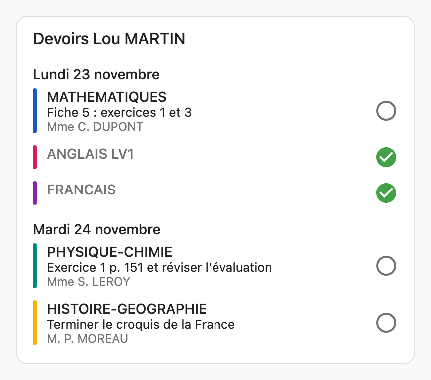
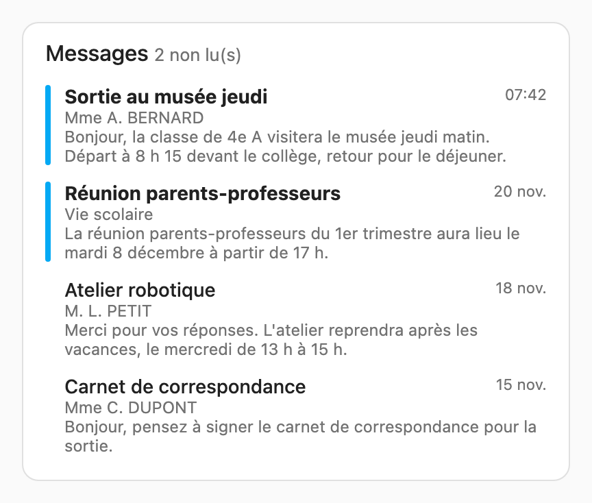
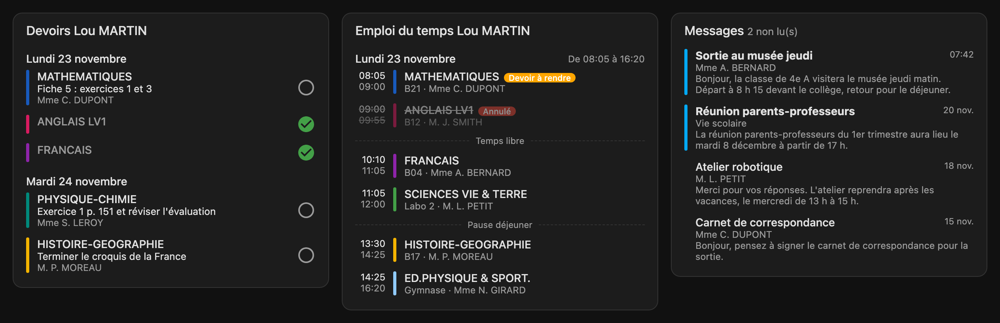

# Skolengo (ENT) pour Home Assistant

> **Projet non officiel.** Sans lien avec Kosmos, ni approuvé ou soutenu par Kosmos.
> « Skolengo » est une marque de son propriétaire.

🇬🇧 [English version](README.md)

Intégration personnalisée Home Assistant pour **Skolengo**, l'ENT de Kosmos utilisé par de nombreuses
régions (par exemple *Mon ENT Occitanie*). Elle utilise la même API que l'application mobile Skolengo.

## État

**v0.1.0, première version.** Testée avec un compte parent de *Mon ENT Occitanie*. Les autres ENT
Skolengo devraient fonctionner mais n'ont pas été testés : les retours sont bienvenus dans les
[tickets](https://github.com/sylvaing/ha-skolengo/issues). Les changements sont listés dans le
[journal des modifications](CHANGELOG.md).

## Fonctions

Pour chaque élève, seulement pour les services ouverts par son établissement :

- **Devoirs** (cahier de textes) : un capteur et une liste de tâches ; cocher un devoir le marque comme
  fait dans l'ENT.
- **Emploi du temps** : un capteur et un calendrier (matières, salles, professeurs, cours annulés).
- **Messagerie** : capteur des messages non lus avec les derniers messages.
- **Cartes Lovelace** livrées avec l'intégration : `skolengo-homework-card`, `skolengo-timetable-card`,
  `skolengo-messages-card`.

Connexion : choisissez votre établissement et votre fournisseur d'identité, puis tapez votre identifiant
et votre mot de passe **EduConnect**. L'intégration se connecte elle-même, sans navigateur ; le mot de
passe n'est pas conservé, seul le jeton de renouvellement l'est.

Les notes et les absences ne sont pas dans la v0.1.0 : dans les établissements qui utilisent Pronote,
Skolengo ne fait que les relayer et l'API échoue souvent. L'[intégration Pronote](https://github.com/delphiki/hass-pronote)
les couvre.

## Entités

| Entité | Par | État | Pour |
| --- | --- | --- | --- |
| `sensor.<élève>_homework` | élève (devoirs ouverts) | devoirs à faire | carte des devoirs |
| `todo.<élève>_homework` | élève (devoirs ouverts) | devoirs à faire | cocher = fait dans l'ENT |
| `sensor.<élève>_timetable` | élève (emploi du temps ouvert) | cours de la journée en cours | carte de l'emploi du temps |
| `sensor.<élève>_next_lesson` | élève (emploi du temps ouvert) | début du prochain cours | automatisations |
| `calendar.<élève>_timetable` | élève (emploi du temps ouvert) | cours actuel / suivant | calendrier |
| `sensor.<compte>_unread_messages` | compte (messagerie ouverte) | conversations non lues | carte des messages |

L'événement `skolengo_new_message` est émis pour chaque nouveau message non lu (`subject`, `sender`,
`date`, `preview`), pour construire des notifications.

## Cartes

<p>
  
  
  
</p>


<sub>Données inventées. Les images sont faites à partir de <a href="docs/screenshots/demo.html">docs/screenshots/demo.html</a> avec <code>scripts/make_screenshots.py</code>.</sub>

Les cartes sont livrées avec l'intégration et chargées automatiquement : aucune ressource à ajouter.
Ajoutez-les depuis le sélecteur de cartes (cherchez « Skolengo ») ou en YAML. Leur apparence et leurs
options reprennent les cartes Pronote de [lovelace-pronote](https://github.com/delphiki/lovelace-pronote)
(code indépendant).

```yaml
type: custom:skolengo-homework-card
entity: sensor.lou_martin_homework
display_header: true
current_week_only: false
display_done_homework: true
reduce_done_homework: true   # devoirs faits : matière seule
enable_slider: false         # un jour à la fois, avec des flèches
```

Cliquez sur le rond d'un devoir pour le marquer fait ou à faire (via la liste de tâches de l'élève ;
renseignez `todo_entity` si elle n'est pas trouvée automatiquement). Seul un compte **élève** le peut :
l'ENT ne permet à un compte parent que de lire les devoirs, la liste et la carte sont alors en lecture
seule.

```yaml
type: custom:skolengo-timetable-card
entity: sensor.lou_martin_timetable
display_header: true
display_lunch_break: true
display_classroom: true
display_teacher: true
display_day_hours: true
dim_ended_lessons: true
display_free_time_slots: true
max_days: 5
current_week_only: false
enable_slider: false
switch_to_next_day: true     # une fois les cours du jour finis, commencer au jour de classe suivant
```

```yaml
type: custom:skolengo-messages-card
entity: sensor.alex_martin_unread_messages
display_header: true
max_messages: 5
unread_only: false
ent_url: https://votre-ent.example   # lien « Ouvrir l'ENT », facultatif
```

## Modèles de notification (blueprints)

Deux modèles d'automatisation, à importer en un clic (ou par **Paramètres → Automatisations et scènes →
Blueprints → Importer un blueprint** avec l'adresse GitHub du fichier) :

| Modèle | Ce qu'il fait | Importer |
| --- | --- | --- |
| [Nouveaux messages](blueprints/automation/skolengo/new_message.yaml) | Une notification pour chaque nouveau message de l'ENT : objet, expéditeur, début du message. | [](https://my.home-assistant.io/redirect/blueprint_import/?blueprint_url=https%3A%2F%2Fgithub.com%2Fsylvaing%2Fha-skolengo%2Fblob%2Fmain%2Fblueprints%2Fautomation%2Fskolengo%2Fnew_message.yaml) |
| [Rappel des devoirs](blueprints/automation/skolengo/homework_reminder.yaml) | Chaque soir à l'heure choisie, les devoirs pour le prochain jour de classe pas encore faits (le vendredi et le samedi : ceux du lundi). Rien n'est envoyé s'il n'y en a pas. | [](https://my.home-assistant.io/redirect/blueprint_import/?blueprint_url=https%3A%2F%2Fgithub.com%2Fsylvaing%2Fha-skolengo%2Fblob%2Fmain%2Fblueprints%2Fautomation%2Fskolengo%2Fhomework_reminder.yaml) |

Les deux notifient un téléphone équipé de l'application Home Assistant, et peuvent aussi lancer
d'autres actions (autre service de notification, enceinte…).

## Documentation

- [API mobile Skolengo — référence non officielle](docs/skolengo-api.md) (en anglais)

## Installation

Par [HACS](https://hacs.xyz) :

1. HACS → ⋮ → **Dépôts personnalisés** → ajoutez `https://github.com/sylvaing/ha-skolengo`, type
   **Intégration**.
2. Installez **Skolengo (ENT)**, puis redémarrez Home Assistant.
3. **Paramètres → Appareils et services → Ajouter une intégration → Skolengo (ENT)** : cherchez
   l'établissement, choisissez votre mode de connexion, puis saisissez votre identifiant et votre mot de
   passe EduConnect.

Les cartes sont disponibles tout de suite (actualisez une fois le navigateur après le redémarrage).

## Confidentialité

Votre mot de passe EduConnect n'est envoyé qu'à EduConnect (`educonnect.education.gouv.fr`) au moment de
la connexion, et n'est pas conservé. Les jetons de session sont stockés uniquement dans Home Assistant et
envoyés uniquement à votre ENT et à l'API Skolengo (`api.skolengo.com`), comme le fait l'application.
L'intégration lit les données scolaires de vos enfants : limitez l'accès à votre Home Assistant en
conséquence.

## Licence

[MIT](LICENSE)
