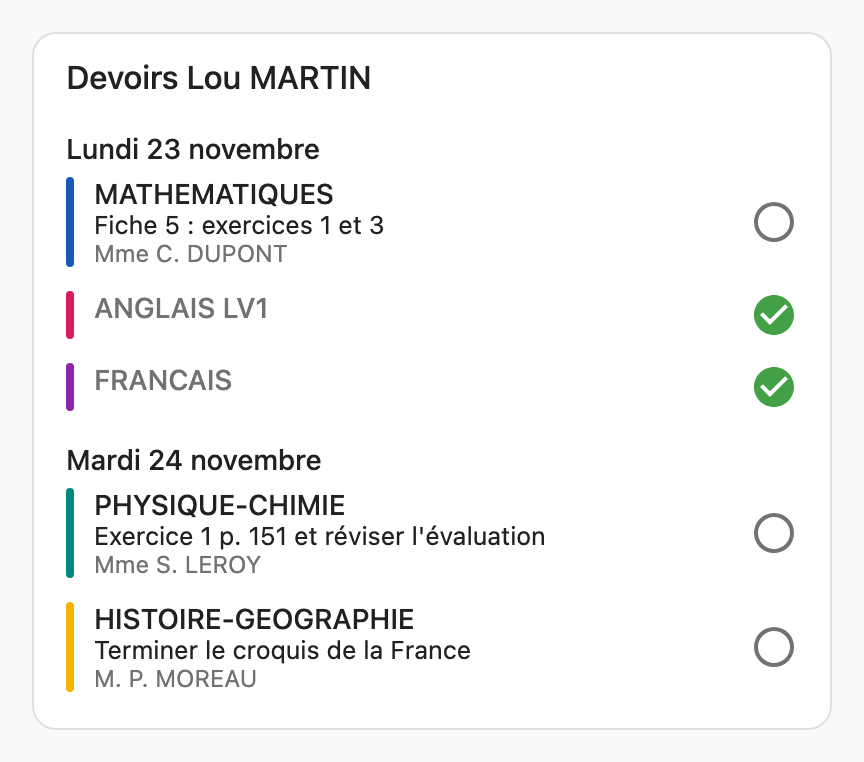
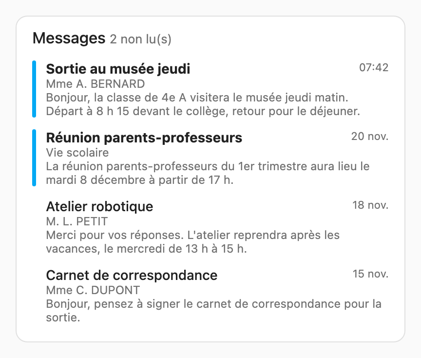
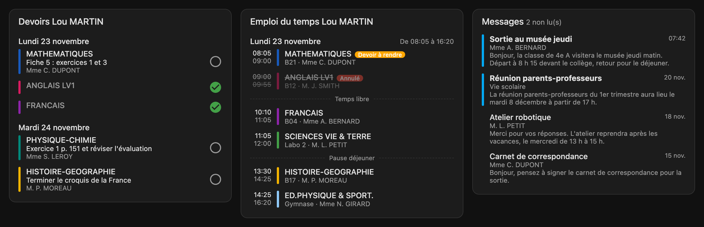

# Skolengo (ENT) for Home Assistant

> **Unofficial project.** Not affiliated with, endorsed by or supported by Kosmos.
> "Skolengo" is a trademark of its owner.

🇫🇷 [Version française](README.fr.md)

Home Assistant custom integration for **Skolengo**, the school ENT (digital workspace) by Kosmos used by
many French regions (e.g. *Mon ENT Occitanie*). It uses the same API as the Skolengo mobile app.

## Status

**v0.2.0.** Tested with a parent account of *Mon ENT Occitanie*. The other Skolengo ENTs (see below)
should work but are untested: reports are welcome in the
[issues](https://github.com/sylvaing/ha-skolengo/issues). Changes are listed in the [changelog](CHANGELOG.md).

## Supported ENTs

Skolengo runs the ENT of several French regions and départements. The table lists the ENTs found in the
Skolengo school directory (the one the mobile app searches) in November 2026, with their number of
schools. All the French ones offer **EduConnect** sign-in for parents and students, which is what the
integration uses, so they should all work.

| ENT | Area | Schools | Status |
| --- | --- | ---: | --- |
| [Mon Bureau Numérique](https://www.monbureaunumerique.fr) | Grand Est region (lycées and collèges) | ~870 | should work |
| [ENT Auvergne-Rhône-Alpes](https://www.ent.auvergnerhonealpes.fr) | Auvergne-Rhône-Alpes region | ~800 | should work |
| [Mon ENT Occitanie](https://www.mon-ent-occitanie.fr) | Occitanie region (académies of Montpellier and Toulouse) | ~710 | **tested** (parent, Toulouse) |
| [ECLAT-BFC](https://eclat-bfc.fr) | Bourgogne-Franche-Comté region, schools included | ~670 | should work |
| [Webcollège](https://www.webcollege.seinesaintdenis.fr) | Seine-Saint-Denis (93) collèges | ~130 | should work |
| [Arsène 76](https://arsene76.fr) | Seine-Maritime (76) collèges | ~110 | should work |
| [Mon collège Val-de-Marne](https://moncollege.valdemarne.fr) | Val-de-Marne (94) collèges | ~110 | should work |
| [eCollège Haute-Garonne](https://ecollege.haute-garonne.fr) | Haute-Garonne (31) collèges | ~100 | should work |
| [Agora 06](https://agora06.fr) | Alpes-Maritimes (06) collèges | ~80 | should work |
| [ENT27](https://ent27.fr) | Eure (27) collèges | ~55 | should work |
| [ENT Creuse](https://www.entcreuse.fr) | Creuse (23) collèges | ~15 | should work |
| Skolengo (hosted) | Private schools and French schools abroad | ~50 | untested: local ENT accounts only |
| schulen.be | German-speaking Community of Belgium | 5 | untested: local ENT accounts only |

Pick the EduConnect choice when the integration asks how you sign in (*Élève ou parent…*, with your
académie when the ENT spans several). The other choices (teachers and staff through their académie,
*Autres comptes et invités* / local ENT accounts) are not tested. FranceConnect, offered on the
EduConnect page, cannot work: it needs a browser. Use your EduConnect login and password instead.

Count measured with the public `/schools` endpoint; test and demo ENTs are left out. Your ENT works, or
does not? Say so in an [issue](https://github.com/sylvaing/ha-skolengo/issues).

## Features

Per student, only for the services their school enables:

- **Homework** (cahier de textes): a sensor and a to-do list; ticking an item marks the homework as done
  in the ENT.
- **Timetable**: a sensor and a calendar (subjects, rooms, teachers, cancelled lessons).
- **Messages**: unread-messages sensor with the latest messages.
- **Lovelace cards** shipped with the integration: `skolengo-homework-card`, `skolengo-timetable-card`,
  `skolengo-messages-card`.

Sign-in: pick your school and your identity provider, then type your **EduConnect** login and password.
The integration signs in itself, without a browser; the password is not stored, only the refresh token.

Grades and absences are out of scope for v0.1.0: on schools that run Pronote, Skolengo only proxies them
and the API often fails. The [Pronote integration](https://github.com/delphiki/hass-pronote) covers them.

## Entities

| Entity | Per | State | For |
| --- | --- | --- | --- |
| `sensor.<student>_homework` | student (homework enabled) | homework not done | homework card |
| `todo.<student>_homework` | student (homework enabled) | homework not done | tick = done in the ENT |
| `sensor.<student>_timetable` | student (timetable enabled) | lessons of the current school day | timetable card |
| `sensor.<student>_next_lesson` | student (timetable enabled) | start of the next lesson | automations |
| `calendar.<student>_timetable` | student (timetable enabled) | current / next lesson | calendar |
| `sensor.<account>_unread_messages` | account (messaging enabled) | unread conversations | messages card |

The event `skolengo_new_message` is fired for each new unread message (`subject`, `sender`, `date`,
`preview`), to build notifications.

## Cards

<p>
  
  
  
</p>


<sub>Invented data. The images are made from <a href="docs/screenshots/demo.html">docs/screenshots/demo.html</a>
with <code>scripts/make_screenshots.py</code>.</sub>

The cards are shipped with the integration and loaded automatically: no resource to add. Add them from
the card picker (search "Skolengo") or in YAML. Their look and options follow the Pronote cards of
[lovelace-pronote](https://github.com/delphiki/lovelace-pronote) (independent code).

```yaml
type: custom:skolengo-homework-card
entity: sensor.lou_martin_homework
display_header: true
current_week_only: false
display_done_homework: true
reduce_done_homework: true   # done items: subject only
enable_slider: false         # one day at a time, with arrows
```

Click the circle of a homework to mark it done or not done (through the student's to-do list; set
`todo_entity` if it is not found automatically). Only a **student** account may do this: the ENT lets a
parent account read the homework only, so the list and the card are then read-only.

```yaml
type: custom:skolengo-timetable-card
entity: sensor.lou_martin_timetable
display_header: true
display_lunch_break: true
display_classroom: true
display_teacher: true
display_day_hours: true
dim_ended_lessons: true
display_free_time_slots: true
max_days: 5
current_week_only: false
enable_slider: false
switch_to_next_day: true     # once today's lessons are over, start at the next school day
```

```yaml
type: custom:skolengo-messages-card
entity: sensor.alex_martin_unread_messages
display_header: true
max_messages: 5
unread_only: false
ent_url: https://your-ent.example   # optional "Open the ENT" link
```

## Notification blueprints

Two automation blueprints, to import in one click (or with **Settings → Automations & scenes →
Blueprints → Import blueprint** and the file's GitHub address):

| Blueprint | What it does | Import |
| --- | --- | --- |
| [New messages](blueprints/automation/skolengo/new_message.yaml) | A notification for each new message of the ENT: subject, sender, beginning of the message. | [](https://my.home-assistant.io/redirect/blueprint_import/?blueprint_url=https%3A%2F%2Fgithub.com%2Fsylvaing%2Fha-skolengo%2Fblob%2Fmain%2Fblueprints%2Fautomation%2Fskolengo%2Fnew_message.yaml) |
| [Homework reminder](blueprints/automation/skolengo/homework_reminder.yaml) | Every evening at the chosen time, the homework due on the next school day and not done yet (on Friday and Saturday: Monday's). Nothing is sent when there is none. | [](https://my.home-assistant.io/redirect/blueprint_import/?blueprint_url=https%3A%2F%2Fgithub.com%2Fsylvaing%2Fha-skolengo%2Fblob%2Fmain%2Fblueprints%2Fautomation%2Fskolengo%2Fhomework_reminder.yaml) |

Both notify a phone running the Home Assistant app, and can run other actions too (another
notification service, a speaker…).

## Documentation

- [Skolengo mobile API — unofficial reference](docs/skolengo-api.md)

## Installation

Through [HACS](https://hacs.xyz):

1. HACS → ⋮ → **Custom repositories** → add `https://github.com/sylvaing/ha-skolengo`, type **Integration**.
2. Install **Skolengo (ENT)**, then restart Home Assistant.
3. **Settings → Devices & services → Add integration → Skolengo (ENT)**: find your school, choose how you
   sign in, then type your EduConnect login and password.

The cards are available right away (refresh the browser once after the restart).

## Privacy

Your EduConnect password is sent only to EduConnect (`educonnect.education.gouv.fr`) during sign-in and
is not stored. The session tokens are stored in Home Assistant only and sent only to your ENT and to the
Skolengo API (`api.skolengo.com`), like the mobile app does. The integration reads your children's school
data: keep your Home Assistant access restricted accordingly.

## License

[MIT](LICENSE)
